


  


<a href="https://github.com/scylladb/seastar/pull/3767"></a>

  


<a href="https://github.com/Muhammad-Ali-Farhan/market-systems-workstation"></a>
<a href="https://github.com/Muhammad-Ali-Farhan/multi-asset-portfolio-research"></a>

  



  



  


  

<!-- Animated SVGs are generated by tools/build.py. Edit the text or numbers there and run: python3 tools/build.py -->
